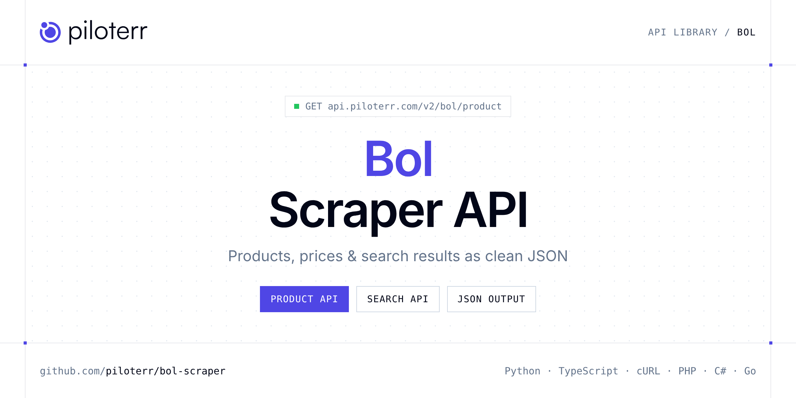

<p align="center">
  <a href="https://www.piloterr.com"></a>
</p>

# Bol Scraper API

[](https://discord.gg/CFj3ph8aHU) [](https://app.piloterr.com) [](https://app.piloterr.com/openapi) [](LICENSE)

The **Piloterr Bol Scraper API** lets you extract public data from Bol as **clean, structured JSON** — no proxies, headless browsers or HTML parsing to maintain. Endpoints available in production:

- **Bol Product API** — Read one bol.com product by URL or product id, in nl, be-nl, or be-fr.
- **Bol Search API** — Search bol.com by keyword.

Use it for price monitoring, assortment tracking, competitor analysis, product research or catalog enrichment.

| Endpoint | Path | Credits | What you get |
|---|---|---|---|
| [Bol Product API](#bol-product-api) | `/v2/bol/product` | 2 | Read one bol.com product by URL or product id, in nl, be-nl, or be-fr. You get the selling price, the list price, and the seller. |
| [Bol Search API](#bol-search-api) | `/v2/bol/search` | 2 | Search bol.com by keyword. Region is nl, be-nl, or be-fr. Page the product cards. Sponsored ads can repeat across pages. |

## Table of contents

- [How it works](#how-it-works)
- [Bol Product API](#bol-product-api)
- [Bol Search API](#bol-search-api)
- [Code examples in other languages](#code-examples-in-other-languages)
- [Practical use cases](#practical-use-cases)
- [Why Piloterr?](#why-piloterr)
- [FAQ](#faq)
- [Official SDKs](#official-sdks)
- [Related scrapers](#related-scrapers)
- [Support](#support)

## How it works

1. **Create a free Piloterr account** and copy your API key from the [dashboard](https://app.piloterr.com).
2. **Send a `GET` (or `POST`) request** to `https://api.piloterr.com/v2/...` with the header `x-api-key: YOUR_API_KEY`.
3. **Receive structured JSON** — Piloterr handles rendering, proxies, retries and parsing.

```bash
export PILOTERR_API_KEY="your-api-key"
pip install requests        # Python
# TypeScript: Node.js 18+ (native fetch), run with `npx tsx file.ts`
```

> Every endpoint accepts both `GET` (query string) and `POST` (JSON body with the same fields).

## Bol Product API

Read one bol.com product by URL or product id, in nl, be-nl, or be-fr. You get the selling price, the list price, and the seller.

`GET | POST https://api.piloterr.com/v2/bol/product` · **2 credits per request** · [Full reference](https://app.piloterr.com/openapi)

### Request parameters

| Parameter | Type | Required | Description |
|---|---|---|---|
| `query` | string | ✅ | Product URL or numeric product id. |
| `region` | string | — | Shop. Use nl for the Netherlands in Dutch, be-nl for Belgium in Dutch, or be-fr for Belgium in French. Leave empty for nl. A full URL picks the shop from the path. |
| `return_page_source` | boolean | — | When true, return the raw HTML as {"result": "..."}. |

### Python example

```python
import json
import os
import requests

response = requests.get(
    "https://api.piloterr.com/v2/bol/product",
    headers={"x-api-key": os.environ["PILOTERR_API_KEY"]},
    params={
        "query": "9300000240171676",
    },
    timeout=120,
)
response.raise_for_status()
data = response.json()

print(json.dumps(data, indent=2, ensure_ascii=False)[:2000])
```

### TypeScript example

```typescript
type BolProduct = {
  mpn?: string;
  url?: string;
  gtin?: string;
  brand?: string;
  color?: string;
  price?: number;
  title?: string;
  images?: string[];
  locale?: string;
  rating?: number;
  region?: string;
  seller?: string;
  series?: string;
  reviews?: {
    body?: string;
    title?: string;
    author?: string;
    rating?: number;
    published_at?: string;
  }[];
  currency?: string;
  delivery?: string;
  variants?: {
    url?: string;
    gtin?: string;
    color?: string;
    price?: number;
    title?: string;
    seller?: string;
    currency?: string;
    condition?: string;
    image_url?: string;
    product_id?: string;
    availability?: string;
    price_display?: string;
  }[];
  brand_url?: string;
  condition?: string;
  image_url?: string;
  highlights?: string[];
  list_price?: number;
  product_id?: string;
  series_url?: string;
  breadcrumbs?: {
    url?: string;
    name?: string;
  }[];
  [key: string]: unknown;
};

const params = new URLSearchParams({
  "query": "9300000240171676",
});

const response = await fetch(`https://api.piloterr.com/v2/bol/product?${params}`, {
  headers: { "x-api-key": process.env.PILOTERR_API_KEY! },
});
if (!response.ok) throw new Error(`Piloterr error ${response.status}: ${await response.text()}`);

const data = (await response.json()) as BolProduct;

console.log(JSON.stringify(data, null, 2).slice(0, 2000));
```

<details>
<summary><b>POST variant</b></summary>

```http
POST https://api.piloterr.com/v2/bol/product
x-api-key: YOUR_API_KEY
Content-Type: application/json

{"query": "9300000240171676"}
```
</details>

### Output example

Example response from the API reference, abridged — real values depend on the page you scrape.

```json
{
  "mpn": "iPhone Air - 256GB - Space Black",
  "url": "https://www.bol.com/nl/nl/p/apple-iphone-air-256gb-space-black/9300000240171676/",
  "gtin": "0195950622669",
  "brand": "Apple",
  "color": "Zwart",
  "price": 895,
  "title": "Apple iPhone Air - 256GB - Space Black",
  "images": [
    "https://media.s-bol.com/B3MRz4rqxr6N/nRJm0wp/1208x1500.jpg",
    "https://media.s-bol.com/NJ6qQlVK3Wy6/DRjxogK/550x309.jpg"
  ],
  "locale": "nl-NL",
  "rating": 5,
  "region": "nl",
  "seller": "example",
  "series": "Apple iPhone 17",
  "reviews": [
    {
      "body": "Licht handzaam mooi krachtig gewoon top",
      "title": "Super toestel. Ondanks wat er gezegd wordt een goede batterij",
      "author": "example",
      "rating": 5,
      "published_at": "2025-12-17"
    },
    {
      "body": "ik gebruik de iphone air nu een paar maanden als opvolger van mijn iphone 15 pro. De air bevalt me beter. Hij is lichter en handzamer en …",
      "title": "state of the art",
      "author": "example",
      "rating": 5,
      "published_at": "2026-06-10"
    }
  ],
  "currency": "EUR",
  "delivery": "Voor 23:59 uur besteld, dinsdag in huis",
  "variants": [
    {
      "url": "https://www.bol.com/nl/nl/p/apple-iphone-air-256gb-cloud-white/9300000240171668/",
      "gtin": "0195950622867",
      "color": "Wit",
      "price": 899,
      "title": "Apple iPhone Air - 256GB - Cloud White",
      "seller": "example",
      "currency": "EUR",
      "condition": "new",
      "image_url": "https://media.s-bol.com/4MB65kz2NG42/Y7R28M0/1205x1500.jpg",
      "product_id": "9300000240171668",
      "availability": "in_stock",
      "price_display": "899,00 €"
    },
    {
      "url": "https://www.bol.com/nl/nl/p/apple-iphone-air-256gb-space-black/9300000240171676/",
      "gtin": "0195950622669",
      "color": "Zwart",
      "price": 895,
      "title": "Apple iPhone Air - 256GB - Space Black",
      "seller": "example",
      "currency": "EUR",
      "condition": "new",
      "image_url": "https://media.s-bol.com/B3MRz4rqxr6N/nRJm0wp/1208x1500.jpg",
      "product_id": "9300000240171676",
      "availability": "in_stock",
      "price_display": "895,00 €"
    }
  ],
  "brand_url": "https://www.bol.com/nl/nl/pb/apple/5070005/",
  "condition": "new",
  "image_url": "https://media.s-bol.com/B3MRz4rqxr6N/nRJm0wp/1208x1500.jpg",
  "highlights": [
    "Apple",
    "2025"
  ],
  "list_price": 1199,
  "product_id": "9300000240171676",
  "series_url": "https://www.bol.com/nl/nl/serie/apple-iphone-17/9700000000011697/",
  "breadcrumbs": [
    {
      "url": "https://www.bol.com/nl/nl/l/elektronica/3136/",
      "name": "Elektronica"
    },
    {
      "url": "https://www.bol.com/nl/nl/l/telefonie-accessoires/3137/",
      "name": "Telefonie & Accessoires"
    }
  ]
}
```

### Response fields

| Field | Type | Description |
|---|---|---|
| `mpn` | string |  |
| `url` | string |  |
| `gtin` | string |  |
| `brand` | string |  |
| `color` | string |  |
| `price` | integer |  |
| `title` | string |  |
| `images` | string[] |  |
| `locale` | string |  |
| `rating` | integer |  |
| `region` | string |  |
| `seller` | string |  |
| `series` | string |  |
| `reviews[]` | object[] |  |
| `reviews[].body` | string |  |
| `reviews[].title` | string |  |
| `reviews[].author` | string |  |
| `reviews[].rating` | integer |  |
| `reviews[].published_at` | string |  |
| `currency` | string |  |
| `delivery` | string |  |
| `variants[]` | object[] |  |
| `variants[].url` | string |  |
| `variants[].gtin` | string |  |
| `variants[].color` | string |  |

## Bol Search API

Search bol.com by keyword. Region is nl, be-nl, or be-fr. Page the product cards. Sponsored ads can repeat across pages.

`GET | POST https://api.piloterr.com/v2/bol/search` · **2 credits per request** · [Full reference](https://app.piloterr.com/openapi)

### Request parameters

| Parameter | Type | Required | Description |
|---|---|---|---|
| `query` | string | ✅ | Keyword or full bol.com search URL. A product URL is rejected. |
| `region` | string | — | Shop. Use nl for the Netherlands in Dutch, be-nl for Belgium in Dutch, or be-fr for Belgium in French. Leave empty for nl. A full URL picks the shop from /nl/nl/, /be/nl/, or /be/fr/. |
| `page` | number | — | Page number, starting at 1. Page 2 asks bol for the next screen of the same search. |
| `return_page_source` | boolean | — | When true, return the raw HTML as {"result": "..."}. |

### Python example

```python
import json
import os
import requests

response = requests.get(
    "https://api.piloterr.com/v2/bol/search",
    headers={"x-api-key": os.environ["PILOTERR_API_KEY"]},
    params={
        "query": "lego",
    },
    timeout=120,
)
response.raise_for_status()
data = response.json()

print(json.dumps(data, indent=2, ensure_ascii=False)[:2000])
```

### TypeScript example

```typescript
type BolSearch = {
  results?: {
    url?: string;
    brand?: string;
    price?: number;
    title?: string;
    locale?: string;
    rating?: number;
    region?: string;
    seller?: string;
    brand_id?: string;
    currency?: string;
    delivery?: string;
    offer_id?: string;
    brand_url?: string;
    image_alt?: string;
    image_url?: string;
    sponsored?: boolean;
    bol_select?: boolean;
    highlights?: string[];
    list_price?: number;
    product_id?: string;
    description?: string;
    availability?: string;
    review_count?: number;
    price_display?: string;
    rating_display?: string;
    [key: string]: unknown;
  }[];
  pagination?: {
    next?: string;
    page?: number;
    per_page?: number;
    total_pages?: unknown;
    total_results?: number;
  };
};

const params = new URLSearchParams({
  "query": "lego",
});

const response = await fetch(`https://api.piloterr.com/v2/bol/search?${params}`, {
  headers: { "x-api-key": process.env.PILOTERR_API_KEY! },
});
if (!response.ok) throw new Error(`Piloterr error ${response.status}: ${await response.text()}`);

const data = (await response.json()) as BolSearch;

console.log(JSON.stringify(data, null, 2).slice(0, 2000));
```

<details>
<summary><b>POST variant</b></summary>

```http
POST https://api.piloterr.com/v2/bol/search
x-api-key: YOUR_API_KEY
Content-Type: application/json

{"query": "lego"}
```
</details>

### Output example

Example response from the API reference, abridged — real values depend on the page you scrape.

```json
{
  "results": [
    {
      "url": "https://www.bol.com/nl/nl/p/lego-icons-rozenboeket-10328/9300000157956429/",
      "brand": "LEGO",
      "price": 47.99,
      "title": "LEGO Botanicals Rozenboeket Decoratief Bloemen Bouwpakket uit de Botanical Collection 10328",
      "locale": "nl-NL",
      "rating": 4.8,
      "region": "nl",
      "seller": "example",
      "brand_id": "4648554",
      "currency": "EUR",
      "delivery": "Voor 23:59 uur besteld, morgen in huis",
      "offer_id": "6cc9ba23-4459-4455-b1f0-dbb512814ec3",
      "brand_url": "https://www.bol.com/nl/nl/pb/lego/4648554/",
      "image_alt": "LEGO Botanical Collection Rozenboeket verpakking, met afbeelding van twaalf rode rozen.",
      "image_url": "https://media.s-bol.com/8Q2W6R9wqArl/BNlmq0Q/550x839.jpg",
      "sponsored": false,
      "bol_select": true,
      "highlights": [
        "822 onderdelen",
        "Geen minifiguren"
      ],
      "list_price": 59.99,
      "product_id": "9300000157956429",
      "description": "LEGO Botanicals Rozenboeket. Type product: Bouwpakket, Aanbevolen leeftijd (min): 18 jaar, Materiaal:...",
      "availability": "in_stock",
      "review_count": 154,
      "price_display": "47,99 €",
      "rating_display": "4,8/5"
    }
  ],
  "pagination": {
    "next": "https://www.bol.com/nl/nl/s/?searchtext=lego&page=2",
    "page": 1,
    "per_page": 29,
    "total_pages": null,
    "total_results": 11622
  }
}
```

### Response fields

| Field | Type | Description |
|---|---|---|
| `results[]` | object[] |  |
| `results[].url` | string |  |
| `results[].brand` | string |  |
| `results[].price` | number |  |
| `results[].title` | string |  |
| `results[].locale` | string |  |
| `results[].rating` | number |  |
| `results[].region` | string |  |
| `results[].seller` | string |  |
| `results[].brand_id` | string |  |
| `results[].currency` | string |  |
| `results[].delivery` | string |  |
| `results[].offer_id` | string |  |
| `results[].brand_url` | string |  |
| `results[].image_alt` | string |  |
| `results[].image_url` | string |  |
| `results[].sponsored` | boolean |  |
| `results[].bol_select` | boolean |  |
| `results[].highlights` | string[] |  |
| `results[].list_price` | number |  |
| `results[].product_id` | string |  |
| `results[].description` | string |  |
| `results[].availability` | string |  |
| `results[].review_count` | integer |  |
| `results[].price_display` | string |  |

## Code examples in other languages

Ready-to-run examples live in the [`examples/`](examples) folder. Each one reads your key from the `PILOTERR_API_KEY` environment variable.

| Language | Product | Search |
|---|---|---|
| cURL (Bash) | [`product`](examples/curl/product.sh) | [`search`](examples/curl/search.sh) |
| PHP | [`product`](examples/php/product.php) | [`search`](examples/php/search.php) |
| C# | [`product`](examples/csharp/Product.cs) | [`search`](examples/csharp/Search.cs) |
| Go | [`product`](examples/go/product.go) | [`search`](examples/go/search.go) |
| Java | [`product`](examples/java/ProductExample.java) | [`search`](examples/java/SearchExample.java) |
| Ruby | [`product`](examples/ruby/product.rb) | [`search`](examples/ruby/search.rb) |
| Node.js | [`product`](examples/nodejs/product.mjs) | [`search`](examples/nodejs/search.mjs) |

## Practical use cases

- **Price monitoring** — Track prices, promotions and availability over time to react to competitors.
- **Assortment & catalog tracking** — Follow new products, delisted items and category changes.
- **Competitor analysis** — Benchmark ranges, brands and positioning across retailers.
- **Product research** — Spot best-sellers and trends from search results.
- **Catalog enrichment** — Pull titles, images and attributes into your PIM or marketplace listings.

## Why Piloterr?

- **No infrastructure** — no proxies, headless browsers or CAPTCHA solving to run yourself.
- **Structured JSON** — stable, documented fields instead of brittle HTML selectors.
- **Pay per request** — transparent credit cost per endpoint, failed requests are retried for you.
- **One API key, hundreds of sources** — Bol plus many other e-commerce, search and company data endpoints in the [Piloterr library](https://www.piloterr.com/library).
- **Any language** — plain HTTPS + JSON, with examples for Python, TypeScript, cURL, PHP, C#, Go, Java, Ruby and Node.js.

## FAQ

### Is it legal to scrape Bol?

Collecting publicly available data is generally allowed in many jurisdictions, but rules depend on your country, the data you collect and how you use it. Avoid personal data unless you have a lawful basis, respect the website's terms where they apply, and get legal advice for your specific use case. This is not legal advice.

### Do I need proxies or a headless browser?

No. Piloterr handles rendering, proxy rotation and retries on its side. You only send an HTTPS request with your `x-api-key` header and receive JSON.

### How much does a request cost?

Credits per call: `/v2/bol/product` **2**, `/v2/bol/search` **2**. See the [Piloterr website](https://www.piloterr.com) for plans.

### What data does the Bol API return?

Each endpoint returns structured JSON: **Bol Product** — `mpn`, `url`, `gtin`, `brand`, `color`, `price`; **Bol Search** — `results[]`, `results[].url`, `results[].brand`, `results[].price`, `results[].title`, `results[].locale`.

### How do I paginate Bol results?

Use the `page` parameter and keep requesting while the response indicates more results.

### Can I target a specific country or language?

Yes, use `region` — see the parameter tables above for accepted values.

### Can I get the raw HTML instead of JSON?

Yes. Set `return_page_source=true` and the response becomes `{"result": "..."}` with the page source.

### Which languages are supported?

Any language that can make an HTTP request. This README shows Python and TypeScript; the [`examples/`](examples) folder contains cURL, PHP, C#, Go, Java, Ruby and Node.js.

## Official SDKs

Use Piloterr from your own language with a typed client:

| SDK | Package | Install |
| --- | --- | --- |
| Node.js | [`@piloterr/sdk`](https://www.npmjs.com/package/@piloterr/sdk) | `npm install @piloterr/sdk` |
| Python | [`piloterr`](https://pypi.org/project/piloterr/) | `pip install piloterr` |
| Go | [`piloterr-go`](https://pkg.go.dev/github.com/piloterr/piloterr-go) | `go get github.com/piloterr/piloterr-go` |
| .NET | [`Piloterr`](https://www.nuget.org/packages/Piloterr) | `dotnet add package Piloterr` |
| Ruby | [`piloterr`](https://rubygems.org/gems/piloterr) | `gem install piloterr` |
| PHP | [`piloterr/sdk`](https://packagist.org/packages/piloterr/sdk) | `composer require piloterr/sdk` |
| Java | [`piloterr-java`](https://github.com/piloterr/piloterr-java) | build from source, see its README |
| CLI | [`@piloterr/cli`](https://www.npmjs.com/package/@piloterr/cli) | `npm install -g @piloterr/cli` |
| MCP server | [`@piloterr/mcp`](https://www.npmjs.com/package/@piloterr/mcp) | `npx -y @piloterr/mcp` |

## Related scrapers

- [About You Scraper API](https://github.com/piloterr/aboutyou-scraper)
- [Action Scraper API](https://github.com/piloterr/action-scraper)
- [Aldi Scraper API](https://github.com/piloterr/aldi-scraper)
- [Alibaba Scraper API](https://github.com/piloterr/alibaba-scraper)
- [AliExpress Scraper API](https://github.com/piloterr/aliexpress-scraper)
- [Allegro Scraper API](https://github.com/piloterr/allegro-scraper)
- [All Piloterr scrapers on GitHub](https://github.com/piloterr)

## Support

- 💬 Join the [Piloterr Discord](https://discord.gg/CFj3ph8aHU) to ask questions and share what you build.
- 📚 Browse the [API reference (OpenAPI)](https://app.piloterr.com/openapi) and the [Piloterr library](https://www.piloterr.com/library).
- 🔑 [Get your API key](https://app.piloterr.com).

---

<p align="center">
  <a href="https://www.piloterr.com">
    <picture>
      <source media="(prefers-color-scheme: dark)" srcset="images/logo-dark.svg">
      
    </picture>
  </a>
  <br>
  <sub>Built by <a href="https://www.piloterr.com">Piloterr</a> — web scraping APIs for e-commerce, search, real estate and more, one API key.</sub>
</p>

<sub>Bol is a trademark of its respective owner. This repository is not affiliated with or endorsed by Bol. Examples are released under the MIT license.</sub>
